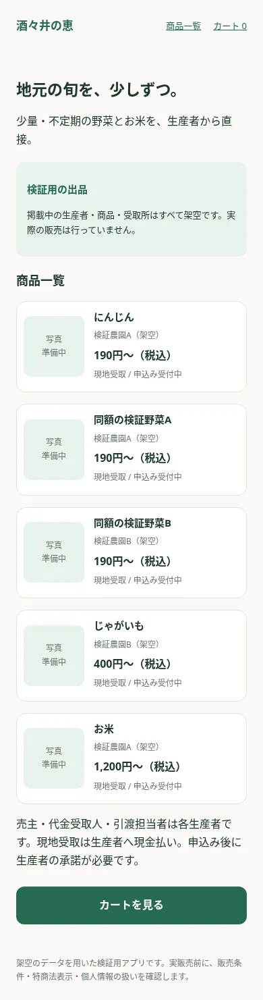
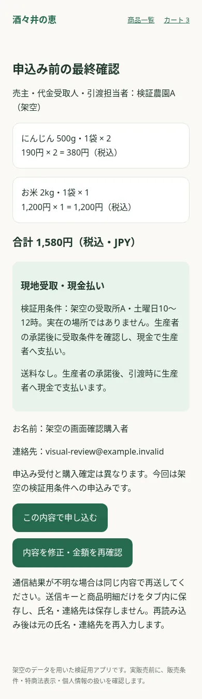
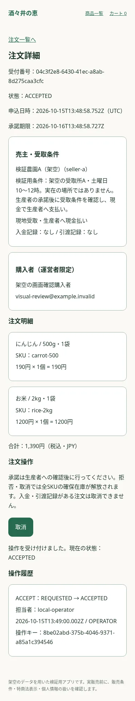

# 実画面レビュー：購入者・運営者（19枚）

公開リポジトリで共有する、実アプリのPlaywrightスクリーンショットです。生成AIやFigma画像の貼り付けではありません。画像はクリックしてGitHub上で原寸表示できます。

- 画面実装の基点：`3ffc71f21d9b56f7124515c7388494c45817f114`。今回の追加はテスト・画像・検証資料・ローカル確認スクリプトのみ。
- Next.js本番ビルドをloopback HTTPで起動。実ローカルD1を0001〜0003で構築。Workerでも同じ画面確認テストを再実行。
- 売主は検証農園A/B（架空）。購入者は「架空の画面確認購入者」、連絡先は `visual-review@example.invalid`。一覧には既存E2Eが作った架空注文も含みます。同額の検証野菜A/Bは同額商品入替テスト専用です。
- 管理画面は毎回生成した署名済みJWTで製品の署名・claim・subject許可判定を通しています。本番Access/IdPの実ログインではありません。
- DOMの連絡先・認証文字列チェック後、全PNGを実物確認してからWebPへ圧縮。JWT/Cookie/秘密鍵・実氏名/住所/連絡先・本番データは公開していません。trace/HAR/DB/.env/プロファイルは含めません。
- 写っているUUIDは架空のローカル受付番号・操作キーです。認証トークンではありません。
- 画像合計：1,015,558 bytes（0.97 MiB）。画像ごとのSHA-256・サイズ・UTC撮影時刻は [manifest.json](./manifest.json)。以下の撮影日時は日本時間（JST）。

## 主要画面のプレビュー

<a href="./02-products-mobile.webp"></a>
<a href="./06-confirm-mobile.webp"></a>
<a href="./13-admin-accepted-mobile.webp"></a>

## 全画像・対応条件

URLはローカルアプリのパスです（公開サイトへの操作リンクではありません）。カート・最終確認・受付は同じ `/cart` 内の状態です。管理一覧の画像08/09は `?status=REQUESTED`、15は `?status=COMPLETED`。

| 画像                                                             | URL                                                  | 画面幅 | 状態・検証データ                                     | 撮影日時（JST）     |
| ---------------------------------------------------------------- | ---------------------------------------------------- | ------ | ---------------------------------------------------- | ------------------- |
| [01-home-mobile.webp](./01-home-mobile.webp)                     | `/`                                                  | 390px  | 公開トップ                                           | 2026-10-15 22:48:56 |
| [02-products-mobile.webp](./02-products-mobile.webp)             | `/products`                                          | 390px  | 公開D1商品一覧                                       | 2026-10-15 22:48:56 |
| [03-products-desktop.webp](./03-products-desktop.webp)           | `/products`                                          | 1280px | 公開D1商品一覧                                       | 2026-10-15 22:48:56 |
| [04-product-mobile.webp](./04-product-mobile.webp)               | `/products/carrot`                                   | 390px  | にんじん・SKU選択・数量入力                          | 2026-10-15 22:48:57 |
| [05-cart-mobile.webp](./05-cart-mobile.webp)                     | `/cart`                                              | 390px  | 同じ売主・2 SKU・3点・参考合計1580円                 | 2026-10-15 22:48:57 |
| [06-confirm-mobile.webp](./06-confirm-mobile.webp)               | `/cart`                                              | 390px  | サーバー再見積1580円・現地受取・現金払い・申込み前   | 2026-10-15 22:48:58 |
| [07-requested-mobile.webp](./07-requested-mobile.webp)           | `/cart`                                              | 390px  | REQUESTED・受付のみ、購入確定ではない                | 2026-10-15 22:48:58 |
| [08-admin-list-mobile.webp](./08-admin-list-mobile.webp)         | `/admin/orders?status=REQUESTED`                     | 390px  | 認証済み・REQUESTED絞り込み・連絡先なし              | 2026-10-15 22:48:59 |
| [09-admin-list-desktop.webp](./09-admin-list-desktop.webp)       | `/admin/orders?status=REQUESTED`                     | 1280px | 認証済み・REQUESTED絞り込み・連絡先なし              | 2026-10-15 22:48:59 |
| [10-admin-detail-desktop.webp](./10-admin-detail-desktop.webp)   | `/admin/orders/04c3f2e8-6430-41ec-a8ab-8d275caa3cfc` | 1280px | 認証済み・REQUESTED・2 SKU・1390円                   | 2026-10-15 22:48:59 |
| [11-admin-detail-mobile.webp](./11-admin-detail-mobile.webp)     | `/admin/orders/04c3f2e8-6430-41ec-a8ab-8d275caa3cfc` | 390px  | 認証済み・REQUESTED・入金/引渡記録なし               | 2026-10-15 22:48:59 |
| [12-admin-confirm-mobile.webp](./12-admin-confirm-mobile.webp)   | `/admin/orders/04c3f2e8-6430-41ec-a8ab-8d275caa3cfc` | 390px  | 承諾確認中・未実行                                   | 2026-10-15 22:48:59 |
| [13-admin-accepted-mobile.webp](./13-admin-accepted-mobile.webp) | `/admin/orders/04c3f2e8-6430-41ec-a8ab-8d275caa3cfc` | 390px  | ACCEPTED・署名済みsubjectの操作履歴あり              | 2026-10-15 22:49:00 |
| [14-admin-rejected-mobile.webp](./14-admin-rejected-mobile.webp) | `/admin/orders/1fa8705e-d524-4754-89a2-a84fff681ba8` | 390px  | REJECTED・担当者付き履歴、全SKU解放済み              | 2026-10-15 22:49:00 |
| [15-admin-empty-mobile.webp](./15-admin-empty-mobile.webp)       | `/admin/orders?status=COMPLETED`                     | 390px  | COMPLETED絞り込み・0件                               | 2026-10-15 22:49:01 |
| [16-admin-denied-mobile.webp](./16-admin-denied-mobile.webp)     | `/admin/orders`                                      | 390px  | 未認証401・管理情報非表示                            | 2026-10-15 22:49:01 |
| [17-cart-empty-mobile.webp](./17-cart-empty-mobile.webp)         | `/cart`                                              | 390px  | カート0件                                            | 2026-10-15 22:49:01 |
| [18-quote-loading-mobile.webp](./18-quote-loading-mobile.webp)   | `/cart`                                              | 390px  | 見積をブラウザfixtureで一時停止・二重確認を禁止      | 2026-10-15 22:49:02 |
| [19-quote-error-mobile.webp](./19-quote-error-mobile.webp)       | `/cart`                                              | 390px  | ブラウザfixtureの見積503・修正再試行可能・注文未作成 | 2026-10-15 22:49:02 |

画像18/19のローディング・エラーは、ブラウザのroute fixtureで見積だけを一時停止／503にした**表示テスト**です。D1障害を実際に発生させた証拠ではありません。画像16はローカルで未認証を拒否する401 JSON表示で、実Accessのログイン画面ではありません。フルページ撮影のため、初期表示範囲外の下方も含みます。

## 再取得（ローカルだけ）

```sh
npm ci
npx playwright install --with-deps chromium
npm run build
# .wrangler/visual-review はこの撮影専用出力。再取得時はこのフォルダだけを空にする。
E2E_RUNTIME=next-production E2E_ADMIN_AUTH=1 VISUAL_REVIEW=1 npm run test:e2e
# 全画像の実物と架空データを確認してから、公開許可された画像だけを書き出す
node scripts/publish-visual-review.mjs --reviewed-fixtures
```

Wranglerユーザー設定の書込みが制限される環境では `XDG_CONFIG_HOME=/tmp/shisui-config WRANGLER_SEND_METRICS=false` を付けます。開発者DBは消さず、ブラウザテスト専用 `.wrangler/e2e-state` だけを再構築します。既存の19枚を更新するときは新しい公開内容を再点検してください。通常のCIは画面確認のassertionを実行しますが `VISUAL_REVIEW` を指定せず、画像やtraceをアップロードしません。

[UI評価・Figma比較・統合準備](../PR_STACK_READINESS.md) / [認証と公開前設定](../OPERATOR_ADMIN.md)
